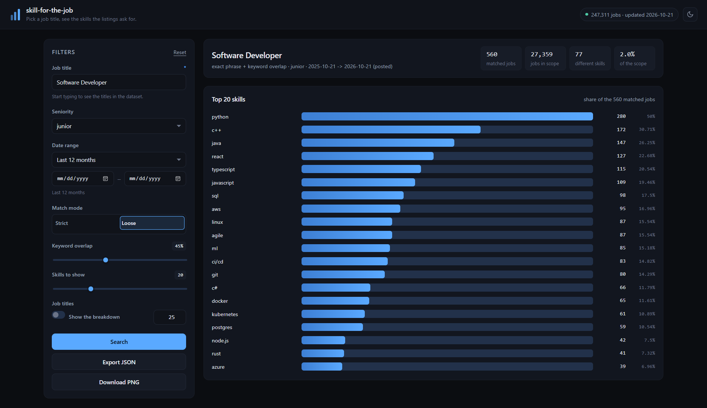
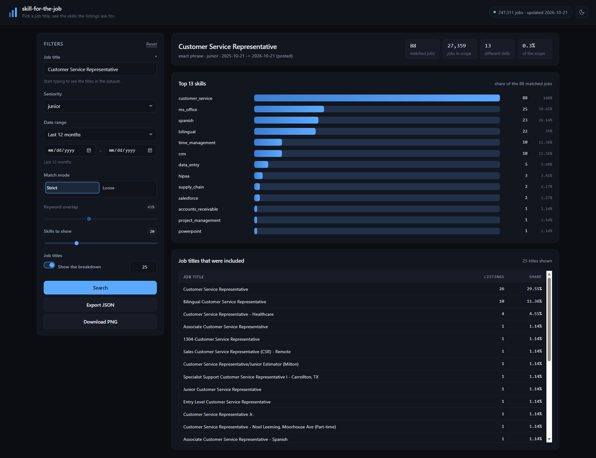
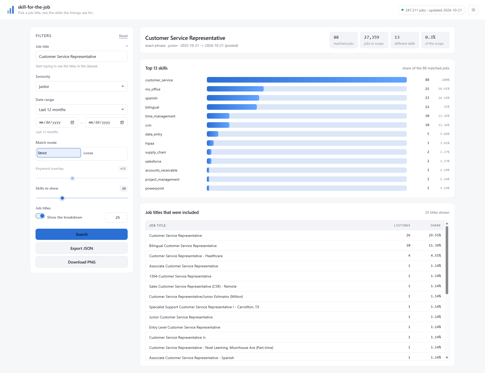

# skill-for-the-job

Job listings from Kaggle ([`chandranshbinjola/job-listings`](https://www.kaggle.com/datasets/chandranshbinjola/job-listings)),
normalised into a compact dataset that can be matched against a list of skills.

> **TL;DR**
>
> - **`python main.py serve`** opens a web interface in the browser: pick a job
>   title, adjust the filters and see the skills that the matching listings ask
>   for, as a histogram.
> - **`python main.py skills "software engineer"`** does the same from the
>   terminal, with `--loose`, `--level`, `--range`, `--titles`, `--plot` and
>   `--json`.
> - **`python main.py update`** refreshes the dataset from Kaggle and
>   **`python main.py doctor`** shows which interpreter and packages are in
>   use.



<div align="center">
  
  
</div>

## Setup

```bash
pip install -r requirements.txt
```

Kaggle credentials go into a `.env` file next to `main.py`:

```
KAGGLE_USERNAME=...
KAGGLE_KEY=...
```

(`KAGGLE_API_TOKEN` is supported as well.)

### Which Python am I running?

Several Python installations can live on the same machine (a virtual
environment, the Microsoft Store alias, the free threaded build, ...).  A
package that is "installed" may still be invisible to the interpreter that
runs the script:

```bash
python main.py doctor
```

```
Interpreter : C:\Program Files\Python314\python.exe
Version     : 3.14.7

Dependencies:
  pandas       3.0.6      ok
  matplotlib   3.11.2     ok
  kaggle       2.2.4      ok
  dotenv       unknown    ok
  flask        3.1.3      ok
```

The command prints the interpreter that runs the script, whether the
dependencies can be imported and the state of the datasets.  If a dependency
is missing it also prints the exact `pip install` command for that
interpreter.

#### The script picks the right interpreter by itself

The free threaded build (`python3.14t.exe`) has its own `site-packages` and
is the default of the `py` launcher on Windows, so `py main.py ...` used to
fail with `ModuleNotFoundError: No module named 'pandas'` even though pandas
was installed for the regular 3.14.

The script now notices that and hands over to an interpreter that has the
dependencies:

```bash
py main.py skills "chef"
```

```
INFO re-running with C:\Program Files\Python314\python.exe
```

The same happens for `py main.py doctor`, a double click on `main.py` or an
editor that picked the free threaded build.  The interpreter can be forced
with an environment variable:

```bash
set SKILL_FOR_THE_JOB_PYTHON=C:\Program Files\Python314\python.exe
```

To see what is installed:

```bash
py -0p                   # list every installed interpreter
python -c "import pandas; print(pandas.__file__)"
```

If a dependency is genuinely missing everywhere, install it for the
interpreter that reports it:

```bash
"path\to\python.exe" -m pip install -r requirements.txt
```

A virtual environment is the safest option for a project:

```bash
python -m venv .venv
.venv\Scripts\activate          # . .venv/bin/activate on macOS/Linux
pip install -r requirements.txt
python main.py skills "software engineer"
```

## Usage

```bash
python main.py                # update + rework + stats
python main.py update         # download the dataset when it is older than 30 days
python main.py update --force # download regardless of the refresh window
python main.py rework         # rebuild the normalised dataset
python main.py rework --preview 10
python main.py stats          # summary of the dataset
python main.py doctor         # interpreter, dependencies and dataset status
python main.py serve          # start the web interface
python main.py skills "software engineer"
python main.py skills "software engineer" --range "2026-01-01 new" --loose
```

## Finding the skills of a job title

The `skills` command takes a target job title and prints a histogram of the
skills that the matching jobs ask for:

```bash
python main.py skills "software engineer"
```

```
Target      : software engineer
Match       : exact phrase
Jobs        : 11,244 of 247,311 (4.5% of the dataset)
Levels      : senior 4,679, mid 3,362, staff+ 2,222, junior 383, ...
Skills found: 103

Top 20 skills (share of the 11,244 matched jobs):

  python                   ████████████████████████████████████   5,008   44.5%
  java                     ███████████████████████   3,153   28.0%
  aws                      █████████████████████   2,973   26.4%
  ...
```

Options:

| Option | What it does |
| --- | --- |
| `--level senior` | only look at one seniority (junior, mid, senior, lead, ...) |
| `--top N` | how many skills to show (default 20) |
| `--range "old 2026"` | only include jobs posted inside a date range |
| `--loose` | also match the titles that only share most of the keywords |
| `--coverage 0.6` | keyword overlap needed for a loose match |
| `--titles N` | list the job titles that were included and their share |
| `--plot skills.png` | also write the histogram as a PNG (needs matplotlib) |
| `--json` | machine readable output |

### Date ranges

The range is written with the `old` and `new` keywords and filters on the
`posted` date of the job:

| Range | Meaning |
| --- | --- |
| `--range "old 2026"` | from the earliest date of the dataset until the end of 2026 |
| `--range "2026-01-01 new"` | from the 1st of January 2026 until the newest date |
| `--range "old 2026 2024-01-01 new"` | from the 1st of January 2024 until the end of 2026 |
| `--range "2024-01-01 2026-12-31"` | two plain dates, read as a range |
| `--range "2026"` | everything posted in 2026 (a year, a month or a day) |

Jobs without a posting date are dropped as soon as a bound is given, because
they cannot be placed inside the range.  Anything that cannot be read as a
date is reported instead of being silently ignored.

### Which titles were included

With `--loose` the script lists every job title that was matched together
with the number of entries it contributed and its share of the matched jobs:

```
Job titles that were included (634 distinct, showing the top 12):

  Data Analyst                                                   72    8.2%
  Senior Data Analyst                                            51    5.8%
  Data Analyst II                                                11    1.3%
  Staff Data Analyst                                              9    1.0%
  ...
  ... and 622 more titles
```

`--titles N` sets how many are shown (50 by default with `--loose`, off
otherwise).

The title is matched in four tiers, the strictest one that matches anything
wins: `exact phrase` → `all keywords` → `keyword overlap` → `fuzzy` (for
typos).  The tier that was used is always shown, and when a looser match
would cover noticeably more jobs the script says so.

## Web interface

The command line is great for scripts, but not for exploring.  The web
interface puts every option of the `skills` command on the page:

```bash
python main.py serve
```

```
INFO web interface on http://127.0.0.1:5000
```

Open <http://127.0.0.1:5000> in the browser.  `python main.py serve --open`
opens it right away, `--host 0.0.0.0` makes it reachable from the network and
`--port` moves it to another port.  The page can also be started with
`python -m skillforjob.web`.

The page is dark by default (a sun in the header switches to the light theme)
and every control has a help text that appears when you hover or focus it.


| Control | What it does |
| --- | --- |
| Job title | the title to look for, with suggestions from the dataset |
| Seniority | only look at one level (any, intern, junior, mid, senior, lead, staff+, manager+) |
| Date range | all dates, the last 30/90 days, the last 12 months, this year, last year, a single year or a custom range |
| Match mode | strict (only the exact title) or loose (also the keyword overlap) |
| Keyword overlap | how many keywords of the title have to appear, 10% - 100% |
| Skills to show | how many skills the histogram shows |
| Job titles | show the breakdown of the matched titles and how many of them |
| Export JSON | download the result as a JSON file |
| Download PNG | download the histogram as a PNG image |

The date presets are turned into the same range strings that `--range` uses,
so both interfaces filter the dataset in exactly the same way.

The result can be shared: the address bar keeps the current search
(`?q=software+engineer&level=senior&loose=1&top=30`) and opens it again.


The same result in the light theme:


### The API

The page talks to a small JSON API, which can also be used directly:

| Route | What it does |
| --- | --- |
| `GET /api/meta` | what the dataset holds: rows, levels, date bounds, popular titles |
| `GET /api/titles?q=chef` | the job titles that contain the search term |
| `POST /api/skills` | the analysis of one job title |
| `POST /api/plot` | the same analysis as a PNG |

```bash
curl -X POST http://127.0.0.1:5000/api/skills \
  -H "Content-Type: application/json" \
  -d '{"target": "software engineer", "level": "senior", "loose": true, "top": 5}'
```

Errors come back as `{"error": "..."}` with the matching status code.

## How it works

| Stage | What it does |
| --- | --- |
| `update` | Downloads `datasets/jobs.csv` from Kaggle into a temporary file and swaps it in atomically, so an interrupted download never truncates the local copy. The download is skipped while the dataset is inside the 30 day refresh window. |
| `rework` | Reads only the columns that are needed, normalises the skills (`;` separated → trimmed, lowercased, de-duplicated, sorted, joined with `\|`), fills in missing levels from the job title and writes `datasets/jobs_reworked.csv`. The result is cached and only rebuilt when the raw export changed. |
| `stats` | Prints the level distribution, the most common skills and the posting dates of the dataset. |
| `skills` | Matches a target title against the reworked dataset and histograms the skills of the matching jobs. |
| `serve` | Starts the web interface: the same analysis behind a page with all the options on it. |

The reworked dataset is roughly a fifth of the raw export and is read back in a
fraction of the time, which matters because the raw file is a few hundred
megabytes.

## Project layout

`main.py` is only the entry point; the work lives in the `skillforjob`
package, one module per job:

```
main.py                     entry point (python main.py ...)
skillforjob/
  __init__.py               package documentation
  __main__.py               python -m skillforjob
  cli.py                    argument parser and the dispatch of every stage
  config.py                 paths, constants and the JSON backed configuration
  logs.py                   the shared logger
  files.py                  atomic writes and human readable sizes
  deps.py                   optional dependency handling (pandas, kaggle, ...)
  interpreter.py            finding the Python interpreter that has the packages
  dataset.py                update / rework / stats: the data pipeline
  dates.py                  parsing and applying the date ranges
  matching.py               matching a job title against the dataset
  skills.py                 the skill histogram (ASCII, JSON and PNG)
  diagnostics.py            the doctor command
  web/                      the web interface
    __init__.py             create_app() and run_server()
    __main__.py             python -m skillforjob.web
    app.py                  the Flask application and the JSON API
    templates/index.html    the single page
    static/style.css        the dark theme
    static/app.js           the page logic
```

The modules only depend on each other downwards, there are no import cycles:

```
cli ──► dataset ──► config ──► files
  │        │                     ▲
  │        ├──► deps ───────────┘
  │        └──► logs
  ├──► skills ──► matching ──► deps
  │        └──► dates
  ├──► diagnostics ──► deps
  ├──► web ──► skills, dataset, dates
  └──► interpreter ──► config
```

## Configuration

`config.json` holds the state of the pipeline:

```json
{
    "DB_last_updated": "2026-10-21",
    "rework": {
        "source": "266996508-1792558917000000000",
        "rows": 247311,
        "built_at": "2026-10-21T16:52:50"
    }
}
```

`rework.source` is the fingerprint (size + mtime) of the raw export the cache
was built from, so the cache is rebuilt automatically after a new download.
